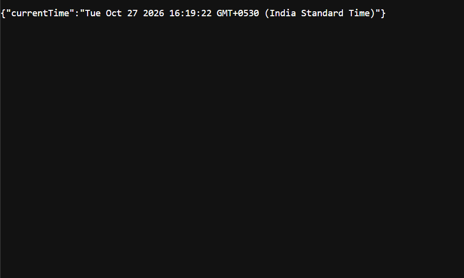

# Lab 1: Node.js and Express Server

**Name:** Lasya  
**Registration Number:** 252U1R8033
**Section:** 113

## Live Link

Not deployed yet.

## Objective

To create a basic HTTP server using Node.js and implement routes using Express.js.

## Technologies Used

- Node.js
- Express.js
- JavaScript
- npm

## Installation and Execution

1. Install Node.js and npm.
2. Open the `lab-01` folder in the terminal.
3. Install dependencies:

   ```bash
   npm install
   ```

4. Start the Express server:

   ```bash
   npm start
   ```

5. Open http://localhost:3000 in your browser.

## Endpoints

| Method | Path | Description | Status |
|---|---|---|---|
| GET | `/` | Returns a welcome message | 200 |
| GET | `/about` | Returns name and section as JSON | 200 |
| GET | `/time` | Returns current date and time | 200 |
| GET | `/unknown` | Returns a 404 message | 404 |

## Screenshots

### Home Route


### About Route


### Time Route


### 404 Route


## Notes

The basic server was created using Node.js's built-in HTTP module. Express.js was used to implement the required routes and handle unknown paths.

## Problems Faced and Solutions

Initially, Node.js was not recognized in the terminal. Restarting VS Code resolved the issue.