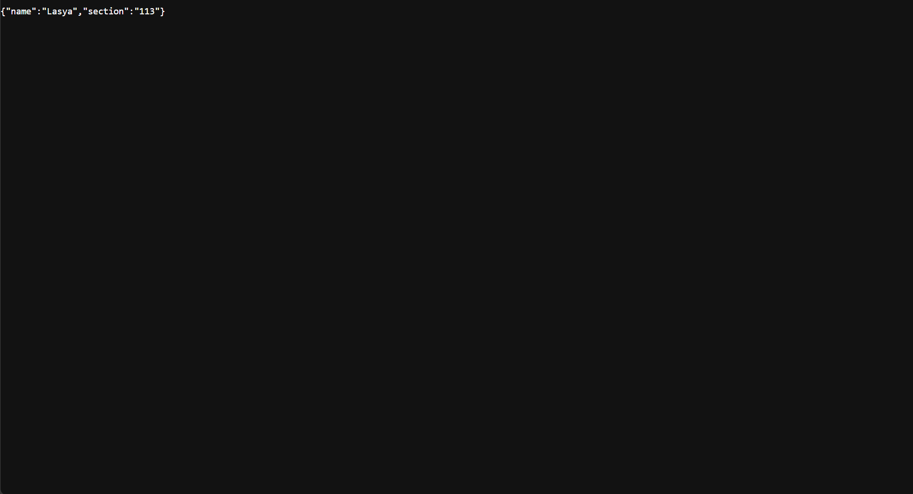

# BDF Lab 1: Node.js and Express Server

## Student Details
- **Name:** Lasya
- **Registration Number:** 252U1R8033
- **Section:** 113

## Aim
To create an HTTP server using Node.js and build an Express server with multiple routes, JSON responses, and a 404 error handler.

## Technologies Used
- Node.js
- Express.js
- JavaScript
- npm

## Installation and Execution

1. Install Node.js.
2. Open a terminal in the `lab-01` directory.
3. Install the dependencies:

   ```bash
   npm install
   ```

4. Start the Express server:

   ```bash
   npm start
   ```

5. Open `http://localhost:3000` in your browser.

## API Endpoints

| Method | Endpoint | Description | Status Code |
|---|---|---|---|
| GET | `/` | Displays the welcome message | 200 |
| GET | `/about` | Returns student details in JSON format | 200 |
| GET | `/time` | Returns the current date and time | 200 |
| GET | `/unknown` | Displays the 404 page-not-found message | 404 |

## Screenshots

### 1. Home Route


### 2. About Route


### 3. Time Route


### 4. 404 Not Found


## Deployment
**Deployment status:** Not deployed yet.


## Environment Variables
No environment variables are required for this lab.

## Notes
- `server.js` contains the Express server implementation.
- `server-http.js` contains the basic Node.js HTTP server implementation.
- `.gitignore` excludes `node_modules/` and `.env` from version control.
