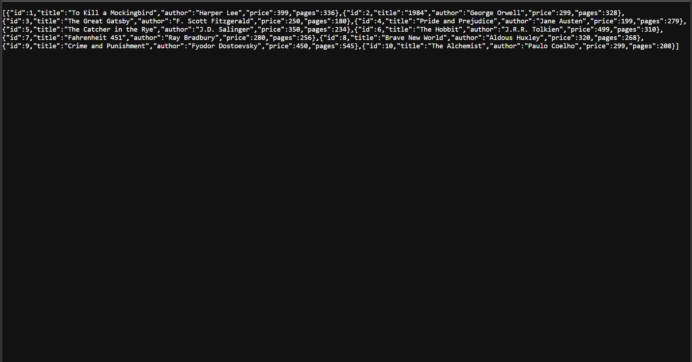
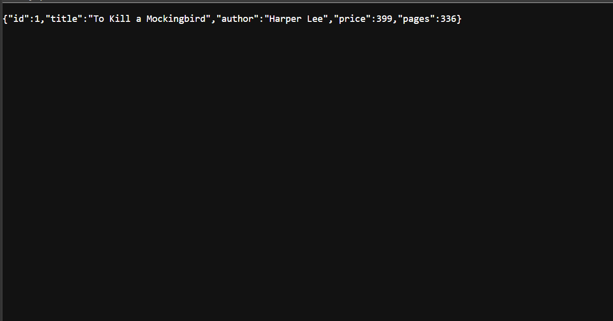
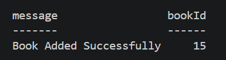
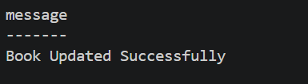
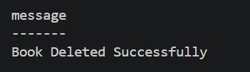
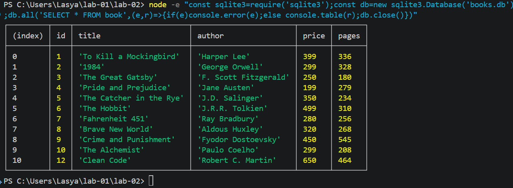

# Lab 2: SQLite database and CRUD routes

## Student Details
- **Name:** Lasya
- **Registration Number:** 252U1R8033
- **Section:** 113

## Live Link
- **Deployment Status:** Not deployed yet.
*(Lab 2 uses a local SQLite database file `books.db`. Once deployment to a cloud platform supporting persistent storage is configured, the live URL will be updated here.)*

## Objective
The objective of this lab is to connect an Express.js server to a SQLite relational database using the `sqlite` and `sqlite3` packages, and expose complete CRUD (Create, Read, Update, Delete) operations over RESTful HTTP routes using parameterized SQL queries.

## Technologies Used
- **Node.js** (v24)
- **Express.js** (v5)
- **SQLite3 & sqlite** (Database driver and async promise-based wrapper)
- **Nodemon** (Development live-reload tool)
- **Postman** (API testing client)

## Installation and Execution

1. Navigate to the `lab-02` directory:
   ```bash
   cd lab-02
   ```

2. Install the required dependencies:
   ```bash
   npm install
   ```

3. (Optional) Initialize or reset the SQLite database with sample records:
   ```bash
   npm run init-db
   ```

4. Start the server with Nodemon (for development auto-restart):
   ```bash
   npm run dev
   ```
   Or start normally with Node:
   ```bash
   npm start
   ```

5. The server will start and listen at:
   ```
   http://localhost:3000/
   ```

## Database Details

- **Database File:** `books.db`
- **Table Name:** `book`

### Schema:
```sql
CREATE TABLE IF NOT EXISTS book (
  id INTEGER PRIMARY KEY AUTOINCREMENT,
  title TEXT NOT NULL,
  author TEXT NOT NULL,
  price INTEGER NOT NULL,
  pages INTEGER NOT NULL
);
```

### Initial Sample Data:
| id | title | author | price | pages |
|---|---|---|---|---|
| 1 | To Kill a Mockingbird | Harper Lee | 399 | 336 |
| 2 | 1984 | George Orwell | 299 | 328 |
| 3 | The Great Gatsby | F. Scott Fitzgerald | 250 | 180 |
| 4 | Pride and Prejudice | Jane Austen | 199 | 279 |
| 5 | The Catcher in the Rye | J.D. Salinger | 350 | 234 |
| 6 | The Hobbit | J.R.R. Tolkien | 499 | 310 |
| 7 | Fahrenheit 451 | Ray Bradbury | 280 | 256 |
| 8 | Brave New World | Aldous Huxley | 320 | 268 |
| 9 | Crime and Punishment | Fyodor Dostoevsky | 450 | 545 |
| 10 | The Alchemist | Paulo Coelho | 299 | 208 |

## API Endpoints

| Method | Endpoint | Description | Status Code |
|---|---|---|---|
| GET | `/books/` | Retrieves all book records from the database | 200 OK |
| GET | `/books/:bookId/` | Retrieves a single book by its ID | 200 OK / 404 Not Found |
| POST | `/books/` | Creates a new book record | 201 Created / 400 Bad Request |
| PUT | `/books/:bookId/` | Updates an existing book record by ID | 200 OK / 404 Not Found / 400 Bad Request |
| DELETE | `/books/:bookId/` | Deletes a book record by ID | 200 OK / 404 Not Found |

## Screenshots

### 1. Get All Books (`GET /books/`)


### 2. Get Single Book by ID (`GET /books/:bookId/`)


### 3. Add a Book (`POST /books/`)


### 4. Update a Book (`PUT /books/:bookId/`)


### 5. Delete a Book (`DELETE /books/:bookId/`)


### 6. Database Records View


## Notes & Problems Faced
1. **Asynchronous Initialization:** Connecting to SQLite is an I/O operation. If the Express server started listening before the database connection was established, incoming requests would encounter null database references. This was resolved by implementing `initializeDBAndServer()`, which awaits the database connection before calling `app.listen()`.
2. **Preventing Accidental Database Resets:** The database setup is placed in `init-db.js` and `setup.sql`, ensuring that regular server restarts (via `nodemon`) do not overwrite modifications made by POST, PUT, or DELETE.
3. **Input Validation:** For POST and PUT routes, missing or non-numeric values for `price` and `pages` are validated upfront to return a `400 Bad Request` before invoking SQL statements.

## Viva Preparation

### 1. Why await the database call?
Database reads and writes are asynchronous input/output (I/O) operations that execute outside the JavaScript main execution thread. If we do not use `await`, JavaScript continues executing the subsequent lines immediately, resulting in a pending Promise rather than the resolved data. Awaiting ensures that query results are returned before sending the HTTP response back to the client.

### 2. What is SQL injection and how do placeholders prevent it?
SQL injection is a severe security vulnerability where untrusted user input is directly concatenated into a SQL statement, allowing an attacker to manipulate query structure, bypass authentication, read unauthorized data, or delete tables (e.g. `' OR '1'='1'`).
Placeholders (`?`) prevent this through **parameterized queries / prepared statements**: the database engine compiles the SQL query structure first, and treats all input passed to `?` strictly as literal data values, never as executable SQL commands.

### 3. When is PUT used instead of POST?
- **POST** is used to create a new resource. The server determines the new resource's URI/ID, and calling POST multiple times creates multiple distinct resources (it is **not idempotent**).
- **PUT** is used to replace or update an existing resource at a known URI (e.g. `/books/:bookId/`). Calling PUT multiple times with the same data produces the same end state (it is **idempotent**).
